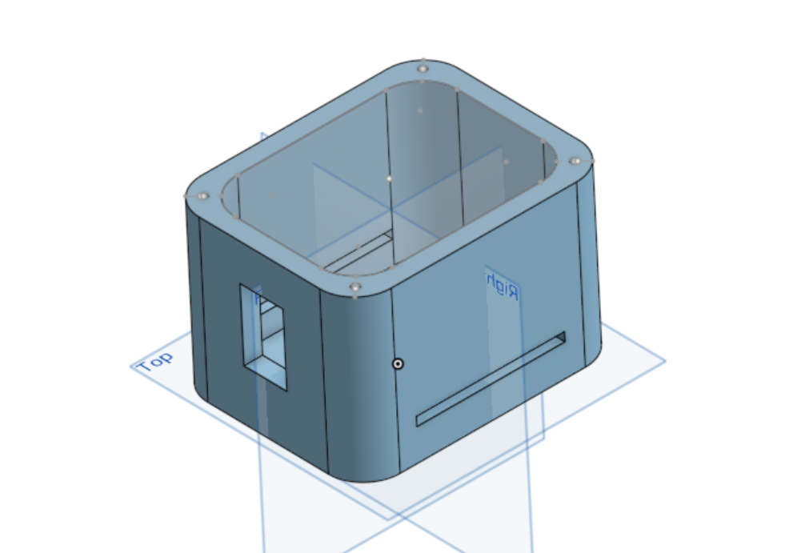
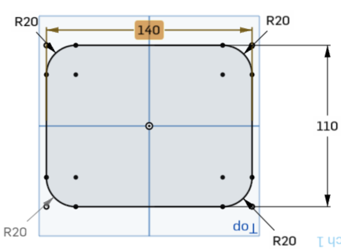
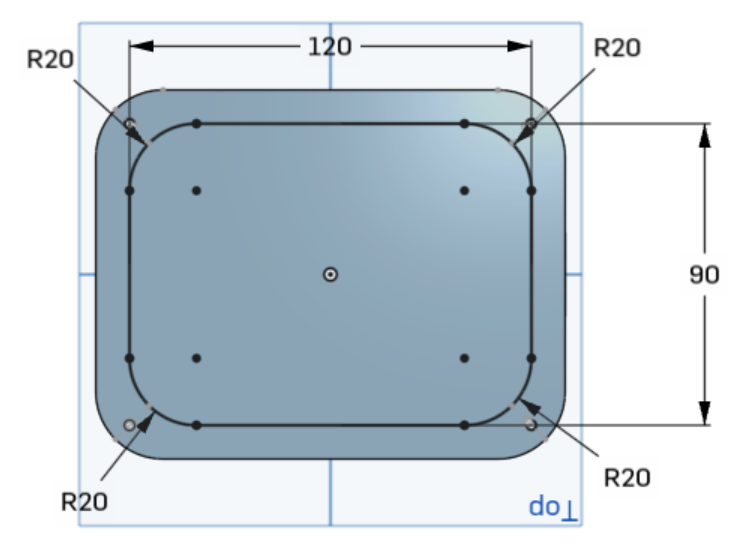
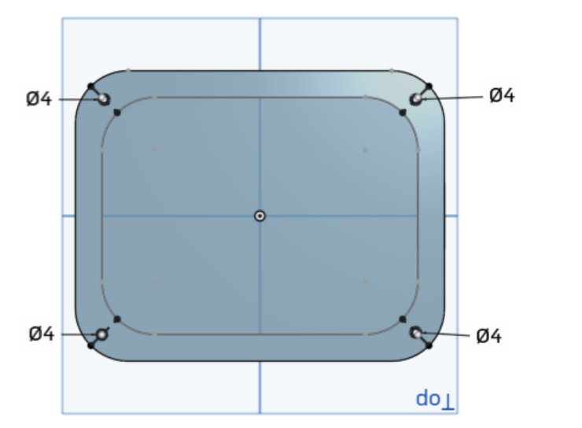
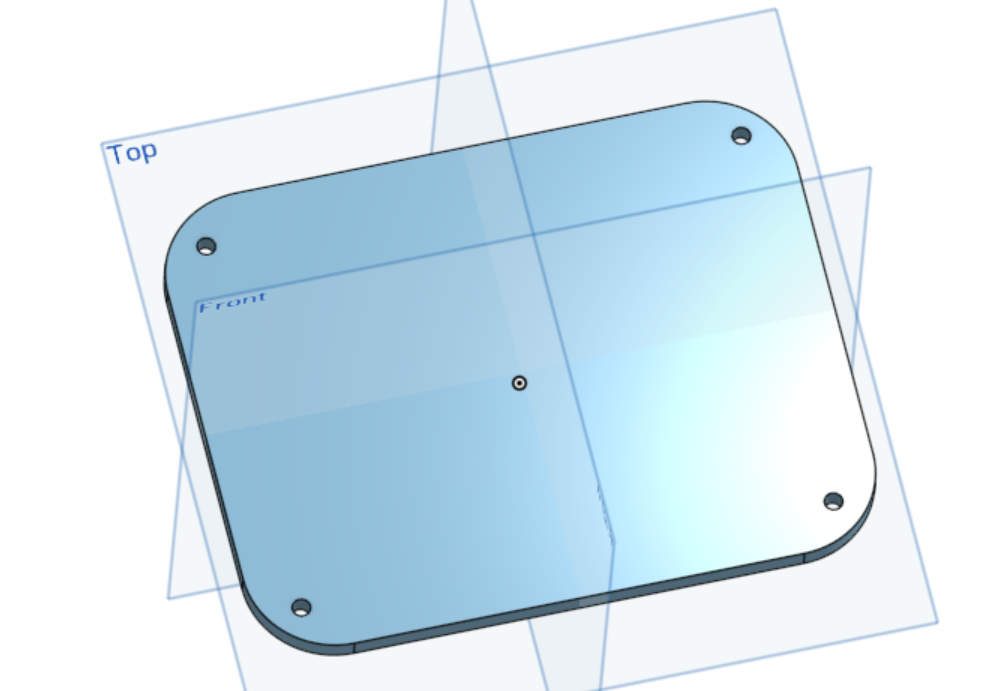

# Table of Contents
1. [Bill of Materials](https://github.com/nturobotics/rover/blob/main/docs/materials.md)
2. [ESP32-Cam Setup](https://github.com/nturobotics/rover/blob/main/docs/coding.md)
3. [3D Design](#3d-design)
   
   3.1 [Container](#container)

   3.2 [Lid](#lid)

6. [Circuit](#circuit)
7. [ESP Guide](#esp-guide)

[OnShape Design](https://cad.onshape.com/documents/e64b89430876cdb7d6b69ab3/w/77c1ce2ce73c963871a615a2/e/e7f76abc5f1c2211f29a23ec?renderMode=0&uiState=6aaf8ad37668e8bcef2a1785)
# 3D-Design
1. Units are all in milimeters (mm)
2. Use measurements in the picture. The measurements in the video tutorial are NOT always same as the ones in the picture.
## Container

### Outer Wall

### Inner Wall

### Top Holes

### Side holes

[side.webm](https://github.com/user-attachments/assets/36426668-020c-44df-9053-4a59281ac936)

### Front hole

### Bottom boles

## Lid

### Cover

### Holes

### Decorated Lid

# Circuit

[Circuit Design](https://app.cirkitdesigner.com/project/c6ccce3c-a848-4c31-a3ae-477986d8f76b)

  
# ESP-guide
- [ESP starter](https://deepbluembedded.com/getting-started-with-esp32-programming-tutorials/)
